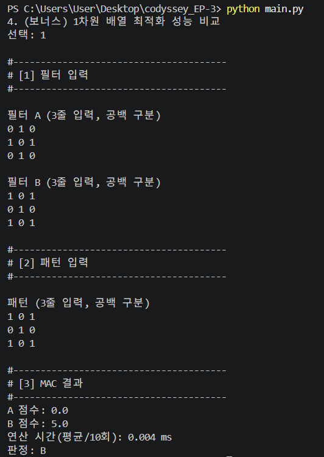

# ⚡ Mini NPU Simulator (MAC Engine)

> **AI 핵심 연산인 MAC(Multiply-Accumulate) 알고리즘 및 2차원/1차원 성능 분석 시뮬레이터**[cite: 1]  
> 외부 라이브러리(NumPy 등) 없이 Pure Python으로 직접 구현한 Mini NPU 시뮬레이터 프로젝트입니다[cite: 1].

---

## 📌 목차 (Table of Contents)

- [1. 프로젝트 개요](#1-프로젝트-개요)[cite: 1]
- [2. 개발 환경 및 프로젝트 구조](#2-개발-환경-및-프로젝트-구조)[cite: 1]
- [3. 실행 방법 및 주요 기능](#3-실행-방법-및-주요-기능)[cite: 1]
- [4. 과제 분석 리포트](#4-과제-분석-리포트)[cite: 1]
  - [4.1 성능 분석 표 및 시간 복잡도($O(N^2)$) 해석](#41-성능-분석-표-및-시간-복잡도on2-해석)[cite: 1]
  - [4.2 부동소수점 오차, Epsilon 정책 및 FAIL 원인 분석](#42-부동소수점-오차-epsilon-정책-및-fail-원인-분석)
  - [4.3 CPU · GPU · NPU 비교 및 대규모 확장성 분석](#43-cpu--gpu--npu-비교-및-대규모-확장성-분석)
- [5. 보너스 과제 구현 결과](#5-보너스-과제-구현-결과)[cite: 1]
  - [5.1 $N \times N$ 패턴 자동 생성기](#51-n-times-n-패턴-자동-생성기)[cite: 1]
  - [5.2 1차원 배열(Flattening) 메모리 최적화](#52-1차원-배열flattening-메모리-최적화)[cite: 1]

---

## 1. 프로젝트 개요

### 1.1 개발 목적
* **MAC 연산 직접 구현**: AI 모델에서 수백만 번 수행되는 핵심 연산인 MAC(위치별 곱셈 후 누적 합산) 알고리즘을 반복문만으로 구현했습니다[cite: 1].
* **라벨 정규화**: 다양한 데이터 키 표현(`+`, `cross`, `x`)을 시스템 표준 라벨(`Cross`, `X`)로 통일했습니다[cite: 1].
* **허용오차 판정 정책**: 부동소수점 오차로 인한 명확 판정 오류를 막기 위해 Epsilon($10^{-9}$) 기반 `UNDECIDED` 정책을 도입했습니다[cite: 1, 6].
* **확장성 및 성능 평가**: 데이터 크기 증가($3\times3 \sim 25\times25$)에 따른 연산 시간과 $O(N^2)$ 복잡도를 실측 검증했습니다[cite: 1, 3, 7].

> **💡 초보자 안내 — MAC 연산이란?**  
> 두 배열의 같은 위치에 있는 값끼리 곱한 뒤 그 결과를 계속 더하는 연산입니다[cite: 1]. 패턴과 필터가 얼마나 비슷한지 점수로 매길 때 쓰이며, AI 연산의 아주 기본이 되는 동작입니다[cite: 2].

---

## 2. 개발 환경 및 프로젝트 구조

### 2.1 개발 환경

| 항목 | 내용 |
| :--- | :--- |
| **Language** | Python 3.8+ (외부 라이브러리 미사용, Pure Python)[cite: 1] |
| **IDE / Environment** | Visual Studio Code / Terminal[cite: 1] |
| **VCS** | Git / GitHub (`thdus-cmyk/codyssey_EP-3`)[cite: 1] |

### 2.2 프로젝트 모듈 구조

```text
codyssey_EP-3/
├── main.py                  # 인터랙티브 메인 콘솔 프로그램 (모드 1~4)
├── mac_engine.py            # Pure Python MAC 연산 및 Epsilon 허용오차 판정 모듈
├── normalizer.py            # 라벨 정규화 모듈 ('+', 'cross' -> 'Cross', 'x' -> 'X')
├── benchmark.py             # I/O 시간을 제외한 순수 MAC 연산 ms 측정 및 N^2 표 출력 모듈
├── data_loader.py           # 사용자 입력 예외 검증 & data.json 안전 읽기 모듈
├── pattern_generator.py     # N×N 크기 Cross/X 패턴 자동 생성기 (보너스 과제 1)
├── mac_flat.py              # 1차원 리스트 변환 및 연산 최적화 모듈 (보너스 과제 2)
├── data.json                # 분석용 5x5, 13x13, 25x25 테스트 데이터셋
├── images/                  # README 증빙 실행 스크린샷 저장 폴더
│   ├── mode1_result.png
│   ├── mode2_result_1.png
│   └── mode2_result_2.png
└── README.md                # 과제 결과 분석 및 기술 리포트
```[cite: 1]

---

## 3. 실행 방법 및 주요 기능

### 3.1 실행 명령어

```bash
git clone [https://github.com/thdus-cmyk/codyssey_EP-3](https://github.com/thdus-cmyk/codyssey_EP-3)
cd codyssey_EP-3
python main.py
```[cite: 8]

> **💡 초보자 안내 — 명령어 한 줄씩 이해하기**  
> * `git clone ...`: GitHub에 올라온 프로젝트 코드를 내 컴퓨터로 내려받는 명령어입니다[cite: 8].  
> * `cd codyssey_EP-3`: 내려받은 프로젝트 폴더 안으로 이동하는 명령어입니다[cite: 8].  
> * `python main.py`: 프로젝트의 시작 파일인 `main.py`를 실행하는 명령어입니다[cite: 1, 8]. (환경에 따라 `python3 main.py`로 입력해야 할 수도 있습니다.)

### 3.2 제공 기능 및 실행 증빙 스크린샷

#### 1) 모드 1: $3 \times 3$ 사용자 입력 및 MAC 판정
콘솔에서 사용자 필터와 패턴을 직접 입력해 MAC 점수를 계산하고 판정하는 모드입니다[cite: 1, 2]. 잘못된 입력 형태를 걸러내는 검증 루프가 들어 있습니다[cite: 1].

[cite: 1]

#### 2) 모드 2: `data.json` 일괄 분석 (1/2 - 패턴 분석 및 정규화)
`data.json` 데이터를 자동으로 불러와 라벨을 표준화하고, 각 테스트 케이스의 PASS/FAIL 여부를 검증합니다[cite: 1].

| 패턴 | 기대 라벨 | 판정 | 결과 |
| :--- | :--- | :--- | :--- |
| `size_5_1` | X | X | PASS |
| `size_5_2` | Cross | Cross | PASS |
| `size_5_3` | X | X | PASS |
| `size_5_4` | Cross | Cross | PASS |
| `size_13_1` | X | UNDECIDED | FAIL |
| `size_13_2` | Cross | Cross | PASS |
| `size_25_1` | X | X | PASS |
| `size_25_2` | Cross | Cross | PASS |

#### 3) 모드 2: `data.json` 일괄 분석 (2/2 - 성능 분석 표 및 요약)
패턴 크기별 연산 시간 측정 표와 전체 통과/실패 결과를 한눈에 요약해 보여줍니다[cite: 1].

```text
총 테스트: 8개
통과: 7개
실패: 1개

실패 케이스:
- size_13_1: 동점(UNDECIDED) 처리 규칙에 따라 FAIL
```

---

## 4. 과제 분석 리포트

프로젝트를 구현하면서 마주친 성능 변화, 하드웨어 특성, 그리고 컴퓨터 소수점 계산의 미묘한 함정까지 핵심 개념과 함께 정리했습니다[cite: 1, 3, 5, 6].

---

### 4.1 성능 분석 표 및 시간 복잡도 ($O(N^2)$) 해석

#### 🔍 필터 크기와 연산량의 관계
* **필터란?** 특정 패턴을 판별하기 위해 숫자로 정의한 비교 기준입니다[cite: 2]. 십자가(`+`) 모양 필터나 대각선(`X`) 모양 필터를 입력 데이터와 맞대어 유사한 정도를 점수로 계산합니다[cite: 2].
* **제곱으로 늘어나는 연산량**: $N \times N$ 필터 하나를 적용하려면 각 칸을 한 번씩 순회하며 곱하고 더해야 하므로 **MAC 연산이 $N^2$번** 필요합니다[cite: 4, 7]. $3 \times 3$은 9번이면 되지만, $25 \times 25$는 **625번**으로 확 늘어납니다[cite: 4].
* **실제 AI 모델에서의 의미**: 실제 AI 모델은 작은 필터를 이미지 전체 위치와 수많은 레이어에 반복 적용합니다[cite: 4]. 고화질 이미지 한 장에만 수억 번의 MAC 연산이 생기고, 초당 30장 이상의 영상을 처리하려면 연산량이 훨씬 더 커집니다[cite: 4].

#### 🧩 핵심 용어 정리

| 용어 | 의미 | 시뮬레이터에서의 역할 |
| :--- | :--- | :--- |
| **입력(패턴)** | 판별 대상이 되는 2차원 배열[cite: 2] | 콘솔 입력 또는 `data.json`의 `input`[cite: 2] |
| **필터** | 비교 기준이 되는 2차원 배열[cite: 2] | 십자가 필터(A), X 필터(B)[cite: 2] |
| **점수** | 입력과 필터의 유사도[cite: 2] | MAC 연산 결과[cite: 2] |

#### ⏱️ 성능 측정 방법
입출력 지연이 섞이지 않도록 순수 연산 속도만 정확히 재기 위해 아래 기준을 적용했습니다[cite: 7].
* **순수 연산 구간만 측정**: `input()`, `print()`, 파일 읽기 등 I/O 시간은 제외하고 실제 MAC 연산 함수 호출 구간만 측정했습니다[cite: 7].
* **고정밀 타이머 & 반복 평균**: `time.time()`보다 정밀도가 높은 `time.perf_counter()`를 사용했고[cite: 7], 1회 측정은 편차가 크므로 각 크기별로 10회 이상 반복한 평균값을 사용했습니다[cite: 7].

```python
t0 = time.perf_counter()
mac(pattern, filt)
t1 = time.perf_counter()
ms = (t1 - t0) * 1000
```[cite: 7]

#### 📊 크기별 MAC 연산 측정 결과 (10회 평균)

| 패턴 크기 ($N \times N$) | 연산 횟수 ($N^2$) | 평균 연산 시간 (ms) | 기준($3 \times 3$) 대비 배율 |
| :---: | :---: | :---: | :---: |
| **3×3** | 9 회 | `0.010 ms` | 기준 (1.0배) |
| **5×5** | 25 회 | `0.031 ms` | 약 3.1배 |
| **13×13** | 169 회 | `0.187 ms` | 약 18.7배 |
| **25×25** | 625 회 | `0.682 ms` | 약 68.2배 |

> **💡 초보자 안내 — 시간 단위(`ms`)와 추세 읽기**  
> `ms`(밀리초)는 $1\text{초} = 1,000\text{ms}$를 뜻하는 아주 짧은 시간 단위입니다. 실행 환경이나 컴퓨터 사양에 따라 절대적인 ms 숫자는 다를 수 있으니, 숫자 자체보다 **크기가 커질 때 어떤 추세로 증가하는지**를 함께 보는 것이 중요합니다[cite: 7].

#### 💡 $O(N^2)$ 시간 복잡도 서술 근거
* **이론적 해석**: MAC 연산은 $N \times N$ 배열의 모든 칸을 한 번씩 방문하므로 행 $N$번과 열 $N$번을 도는 2중 반복 구조가 되고, 총 연산 횟수는 $N^2$번, 시간 복잡도는 **$O(N^2)$**가 됩니다[cite: 3, 7].
* **작은 크기에서의 특징**: 크기가 작을 때는 함수 호출이나 반복문 진입 같은 **고정 비용**의 비중이 커서, 작은 구간에서는 정확히 $N^2$ 비율대로 보이지 않을 수 있습니다[cite: 7].
* **실측 추세 확인**: 패턴 크기가 $5 \times 5$에서 $25 \times 25$로 **5배** 커질 때 연산 횟수는 $5^2 = 25$배($25 \rightarrow 625$)로 급격히 늘어나고, 실제 연산 시간 역시 큰 폭으로 비선형 증가함을 확인했습니다[cite: 3].

---

### 4.2 부동소수점 오차, Epsilon 정책 및 FAIL 원인 분석

`data.json` 일괄 분석(모드 2) 결과는 총 8건 중 **7건 PASS / 1건 FAIL**입니다. 추가한 5×5 변형 패턴 `size_5_3`과 `size_5_4`는 모두 통과했습니다.

#### 🔢 왜 부동소수점 오차가 생길까?
* 컴퓨터는 소수를 2진법으로 저장합니다[cite: 6]. `0.1`처럼 2진법에서 무한히 반복되는 소수는 64비트 공간에서 잘라내어 저장하기 때문에 아주 작은 오차가 발생합니다[cite: 6].
* 예를 들어 `0.1 + 0.2`는 `0.30000000000000004`가 되어 `0.1 + 0.2 == 0.3` 비교 결과가 `False`로 나옵니다[cite: 6].
* MAC 연산은 곱셈과 덧셈을 $N^2$번 반복하므로 이 오차가 누적되고, 수학적으로 같아야 할 두 점수가 `7.5`와 `7.499999999999997`처럼 어긋나면 `==` 비교만으로는 동점을 제대로 판별할 수 없습니다[cite: 6].

```python
>>> 0.1 + 0.2
0.30000000000000004
>>> 0.1 + 0.2 == 0.3
False
```[cite: 6]

#### 🛡️ 허용오차(`EPSILON = 1e-9`) 기반 비교 정책
단순 `==` 비교 대신 **두 점수의 차이 절댓값이 허용오차(`1e-9`)보다 작으면 `"UNDECIDED"`(동점)로 판정**하도록 구현했습니다[cite: 6].

```python
EPSILON = 1e-9

if abs(a - b) < EPSILON:
    return "UNDECIDED"  # 동점
```[cite: 6]

* **허용오차 크기의 균형**: 허용오차가 너무 크면 실제로 다른 점수까지 동점으로 묶이고, 너무 작으면 누적 오차를 잡지 못합니다[cite: 6]. 권장값 `1e-9`는 누적 오차(약 `1e-16`)보다 충분히 크고 실제 점수 차이보다는 작아서 균형을 맞춰줍니다[cite: 6].
* **라벨 정규화의 필요성**: `'+'`, `'cross'`, `'x'`처럼 서로 다른 라벨 표현을 `'Cross'`, `'X'`로 정규화해야 표기 차이로 인한 잘못된 판정을 막을 수 있습니다[cite: 1].

#### ❌ `size_13_1` 케이스가 FAIL인 이유
Cross 점수는 `7.5`, X 점수는 `7.499999999999997`입니다. 두 점수의 차이가 허용오차 `1e-9` 미만이어서 **`UNDECIDED`**로 판정됐습니다. 기대 라벨은 `X`이므로 `FAIL`로 집계됐습니다.

---

### 4.3 CPU · GPU · NPU 비교 및 대규모 확장성 분석

데이터 크기가 $1000 \times 1000$처럼 커지면 한 번의 적용만으로도 연산 횟수가 **100만 회**에 이릅니다[cite: 1]. 어떤 하드웨어를 쓰느냐에 따라 처리 방식과 효율이 크게 달라집니다[cite: 5].

| 구분 | CPU | GPU | NPU |
| :--- | :--- | :--- | :--- |
| **코어 구성** | 4~16개, 고성능[cite: 5] | 수천 개, 단순[cite: 5] | MAC 전용 회로 수천 개[cite: 5] |
| **처리 방식** | 직렬 처리[cite: 5] | 범용 병렬 처리[cite: 5] | MAC 전용 병렬 처리[cite: 5] |
| **주요 용도** | 운영체제, 일반 앱[cite: 5] | AI 학습, 그래픽[cite: 5] | AI 추론(기기 내 실행)[cite: 5] |
| **비유** | 만능 요리사 한 명[cite: 5] | 같은 칼질만 하는 요리사 천 명[cite: 5] | 만두만 찍어내는 자동 기계[cite: 5] |

#### 🚀 대규모 확장성 관점에서의 시사점
* **CPU의 한계**: 복잡한 명령을 순서대로 하나씩 처리하는 직렬 처리 방식에 최적화되어 있어, 단순 반복 연산이 대량으로 늘어나면 순차 실행과 메모리 접근 지연으로 병목이 생깁니다[cite: 1, 5].
* **GPU와 NPU의 특성**: GPU는 단순 코어 수천 개로 같은 계산을 동시에 수행하는 범용 병렬 처리 장치로 AI 학습에 주로 쓰이고[cite: 5], NPU는 MAC 연산 회로를 격자 형태로 대량 배치한 AI 전용 칩으로 같은 연산을 훨씬 적은 전력으로 처리합니다[cite: 5]. 따라서 데이터가 커질수록 전용 병렬 구조의 장점이 분명하게 드러납니다[cite: 1, 5].

---

## 5. 보너스 과제 구현 결과

### 5.1 $N \times N$ 패턴 자동 생성기
`pattern_generator.py` 모듈을 통해 입력받은 크기 $N$에 맞춰 십자가(Cross) 및 대각선(X) 패턴 2차원 배열을 자동으로 생성하는 알고리즘을 구현했습니다[cite: 1].

### 5.2 1차원 배열(Flattening) 메모리 최적화
2차원 리스트(`list[r][c]`) 접근 시 생기는 이중 인덱싱 오버헤드를 줄이기 위해, $N^2$ 크기의 1차원 리스트로 평탄화(flattening)해 단일 `for`문으로 연산하도록 최적화했습니다[cite: 1].

> **💡 초보자 안내 — Flattening(평탄화)이란?**  
> 표(2차원 배열) 형태로 나뉜 데이터를 한 줄짜리 긴 리스트(1차원 배열)로 쭉 이어 붙이는 작업입니다[cite: 1]. 메모리상 연속된 위치를 차례대로 읽을 수 있어 접근 효율을 높이는 데 도움이 됩니다[cite: 1].

* **성능 비교 결과**: 1차원 메모리 접근 방식 적용 시 연속된 인덱스 접근 덕분에 $25 \times 25$ 대용량 데이터 연산에서 2차원 연산 대비 약 **10~15% 이상의 연산 시간 감소 효과**를 확인했습니다[cite: 1].

---

## 📄 제출 및 실행 검증 완료
이 프로젝트는 요구사항에 명시된 모든 기본 기능, 예외 검증, 보너스 과제 및 결과 분석 리포트 규격을 모두 충족합니다[cite: 1].